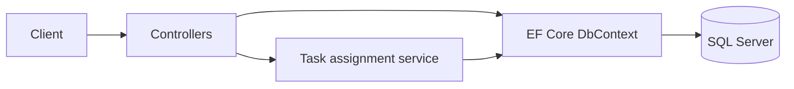

# TaskFinanceAPI

TaskFinanceAPI is a portfolio REST API for managing users and the tasks assigned to them. It stores a balance per user and an optional value (defaulting to zero) per task. A task can be pending or completed. The API demonstrates relational persistence, request validation, and automated testing.

## Features

- Create, list, view, update, and delete users and tasks.
- Assign tasks to existing users and reassign them when updating a task.
- View a user's tasks and delete them automatically when their owner is deleted.
- Discover the HTTP contract through OpenAPI and read standardized Problem Details errors.

## Stack and architecture

.NET 10 LTS, ASP.NET Core controllers, EF Core 10, SQL Server 2022, xUnit, Docker Compose, and GitHub Actions.



Controllers handle HTTP, DTOs define the wire contract, and the task service checks ownership on create and update. EF Core projects query results into DTOs and enforces the existing relational schema. EF Core's change tracking and unit of work handle writes directly. The migrations retain the original tables and map the public numeric task status to the existing `Concluida` bit column.

| Path | Contents |
| --- | --- |
| `TaskFinanceAPI/Controllers` | User and task endpoints |
| `TaskFinanceAPI/DTOs` | Request validation and response contracts |
| `TaskFinanceAPI/Services` | Task assignment and persistence exception handling |
| `TaskFinanceAPI/Data`, `Models`, `Migrations` | EF Core configuration, entities, and schema history |
| `TaskFinanceAPI.Tests` | HTTP integration tests |
| `TaskFinanceAPI/TaskFinanceAPI.http` | Sequential example requests |
| `.github/workflows/ci.yml` | Build, SQLite and SQL Server tests, and Docker build |

## Prerequisites

Use Docker Engine and Docker Compose v2 on an x86-64 host for the full stack. The SQL Server container requires at least 2 GB of memory. For native development, install the .NET 10 SDK and provide a reachable SQL Server instance. Commands below use Bash and run from the repository root.

## Docker setup

Generate a local-only password once, leaving any existing `.env` in place. The examples use OpenSSL.

```bash
if [ ! -f .env ]; then
  (umask 077; printf 'MSSQL_SA_PASSWORD=Aa1!%s\n' "$(openssl rand -hex 24)" > .env)
fi
docker compose up --build -d
docker compose ps -a
curl --fail http://localhost:5010/health/live
curl --fail http://localhost:5010/api/Usuarios
```

The `.env.example` file shows the required variable name. Compose waits for SQL Server to accept queries, then runs the EF migration bundle as the one-shot `migrate` service. The API starts after migration succeeds. If startup fails, inspect `docker compose logs sql migrate api`. The database port is internal to the Compose network. The API binds to the host loopback interface.

`docker compose down` stops the stack and preserves the database volume. Keep the same password between runs for the stored SQL Server login. After adding a migration, rebuild and explicitly apply the updated bundle before restarting the API:

```bash
docker compose build migrate api
docker compose run --rm migrate
docker compose up -d api
```

## Native setup and migrations

Set `ConnectionStrings__DefaultConnection` in your shell from a securely configured local SQL Server connection. Point it at a separate development database. Use a principal permitted to create or update the schema when applying migrations.

```bash
dotnet restore TaskFinanceAPI.sln
dotnet tool restore
dotnet ef database update --project TaskFinanceAPI
dotnet run --project TaskFinanceAPI --launch-profile http
```

To check the EF model against the checked-in snapshot and generate reviewable SQL:

```bash
dotnet ef migrations has-pending-model-changes --project TaskFinanceAPI
dotnet ef migrations script --idempotent --project TaskFinanceAPI --output /tmp/taskfinance-migrations.sql
```

| Variable | Purpose |
| --- | --- |
| `ConnectionStrings__DefaultConnection` | SQL Server connection string for the application and EF tooling. Compose builds it from its local configuration. |
| `MSSQL_SA_PASSWORD` | Local Docker SQL Server password. The generated password avoids connection-string delimiters. |
| `TASKFINANCE_TEST_SQLSERVER` | Optional connection to a disposable SQL Server instance where the test account can create and drop databases. |

Compose trusts the local container's self-signed SQL Server certificate. Use a trusted certificate and normal certificate validation when connecting to a remote server.

## API endpoints

The base URL for both workflows is `http://localhost:5010`. OpenAPI is available at `GET /openapi/v1.json`; `GET /health/live` checks the HTTP process.

| Method | Users | Tasks | Success |
| --- | --- | --- | --- |
| GET | `/api/Usuarios` | `/api/Tarefas` | 200 |
| GET | `/api/Usuarios/{id}` | `/api/Tarefas/{id}` | 200 |
| POST | `/api/Usuarios` | `/api/Tarefas` | 201 with a Location header |
| PUT | `/api/Usuarios/{id}` | `/api/Tarefas/{id}` | 204 |
| DELETE | `/api/Usuarios/{id}` | `/api/Tarefas/{id}` | 204, including repeated deletions |

Invalid inputs return 400. GET and PUT return 404 for missing resources, and task POST and PUT return 404 for a missing owner. Database constraint and concurrent write conflicts return 409 when detected.

### Example

```bash
curl --fail-with-body -i http://localhost:5010/api/Usuarios \
  -H 'Content-Type: application/json' \
  -d '{"nome":"Alex Taylor","saldo":50}'
```

Example 201 response body:

```json
{"id":1,"nome":"Alex Taylor","saldo":50,"tarefas":[]}
```

Use the returned user ID when creating a task:

```bash
curl --fail-with-body -i http://localhost:5010/api/Tarefas \
  -H 'Content-Type: application/json' \
  -d '{"nome":"Review budget","descricao":"Review the example budget","valor":0,"idUsuario":1,"status":0}'
```

Task status is numeric: `0` is pending and `1` is completed. Requests use the original Portuguese JSON field names. See [TaskFinanceAPI.http](TaskFinanceAPI/TaskFinanceAPI.http) for a longer sequence using fictitious data.

## Automated tests

```bash
dotnet test TaskFinanceAPI.sln --configuration Release
```

The default suite exercises the HTTP pipeline and persistence using an isolated in-memory SQLite database per test. SQLite keeps local testing fast and exercises relational behavior, with provider-specific SQL and migration behavior covered by the SQL Server run. Export `TASKFINANCE_TEST_SQLSERVER` before running the same command to run against SQL Server. Each test creates a unique database, applies the checked-in migrations, and drops the database afterward. CI runs both providers and builds the Docker image.

## Known limitations

- The API has no authentication or per-user authorization. Run it with fictitious data on a trusted development machine. Production use with real data requires access controls and HTTPS at the public boundary.
- List endpoints return all records. Larger datasets would require pagination.
- Existing monetary fields retain SQL Server `float` for compatibility. Financial accounting would require a deliberate migration to a decimal type and explicit rounding rules.
- The liveness endpoint checks the HTTP process. A successful database-backed request confirms database connectivity.
